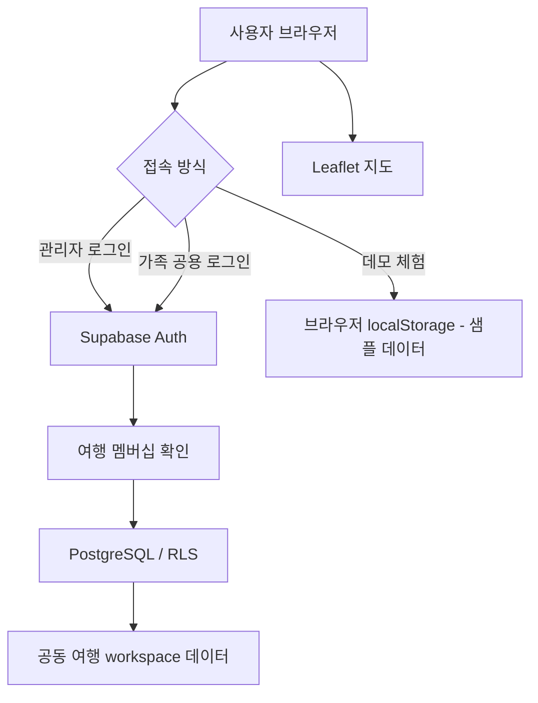

# My Sydney ✈️

### 가족이 함께 계획하고 관리하는 시드니 여행 대시보드

**My Sydney**는 항공편, 숙소, 일정, 저장 장소, 여행 경비와 준비물을 한곳에서 관리하는 가족여행 웹 애플리케이션입니다. 가족이 각자의 기기에서 동일한 여행 정보를 확인하고 수정할 수 있도록 Supabase 기반 공동 저장 기능을 구현했습니다. 포트폴리오 방문자를 위한 **별도 데모 모드**도 제공합니다.

[🌐 라이브 데모](https://rhdbrud031221.github.io/my-sydney-travel-planner/) · [💻 GitHub 저장소](https://github.com/rhdbrud031221/my-sydney-travel-planner)

> **포트폴리오 방문자 안내:** 실제 가족 여행 정보는 비공개 로그인 공간에 보관합니다. 위 사이트에서 **데모 체험**을 선택하면 샘플 데이터로 주요 기능을 살펴볼 수 있습니다.

## 1. 프로젝트 개요

| 항목 | 내용 |
| --- | --- |
| 프로젝트 유형 | 개인 웹 개발 프로젝트 |
| 개발 시기 | 2026년 11월 |
| 목적 | 가족여행 정보 통합 관리 및 여러 기기 간 공유 |
| 주요 사용자 | 여행 관리자, 가족 공용 계정, 데모 방문자 |
| 배포 | GitHub Pages |
| 데이터 저장 | Supabase PostgreSQL, 브라우저 localStorage(데모) |

### 기획 배경

가족여행을 준비하면서 항공편 정보, 예약 숙소, 방문 장소, 예상 지출과 준비물을 각각 따로 확인해야 하는 불편함이 있었습니다. 이를 개선하기 위해 여행 정보를 한 화면에서 확인하고, 가족 구성원이 함께 수정할 수 있는 반응형 여행 대시보드를 개발했습니다.

## 2. 주요 기능

| 기능 | 내용 |
| --- | --- |
| Trip Overview | 여행 핵심 정보와 일정·예산·준비 현황 요약 |
| 항공편 | 출도착 공항·일시, 항공사·편명, 탑승자 및 좌석 관리 |
| 숙소 | 호텔 주소, 체크인·체크아웃, 시설 및 메모 관리 |
| 여행 일정 | 날짜별 방문 계획 등록·수정·삭제 |
| 장소·지도 | 관광·쇼핑·카페·음식점 분류, Leaflet 기반 지도 핀, 장소별 예상 지출 |
| 경비 | 여행 지출 기록 및 관리 |
| 준비물 | 필수준비물·개인준비물 구분, 체크 상태 및 진행률 |
| 가족 공유 | 관리자 및 가족 공용 로그인, 동일한 여행 데이터 조회·편집 |
| 공개 데모 | 로그인 없이 샘플 데이터로 주요 화면과 기능 체험 |

## 3. 화면 구성

- **프리미엄 대시보드:** 네이비 사이드바와 카드 기반 정보 구성
- **항공편·호텔:** 여행 예약 정보 관리
- **장소·지도:** 저장한 장소의 위치와 예상 비용 확인
- **일정·경비·준비물:** 여행 중 필요한 정보를 한곳에서 관리

> 스크린샷 추가 예정: 실제 가족 정보가 없는 **데모 모드**에서 화면을 캡처하여 `docs/screenshots/`에 넣을 계획입니다. 항공편 좌석, 이름, 예약번호 등 개인 정보가 포함된 화면은 공개하지 않습니다.

## 4. 기술 스택

| 영역 | 기술 |
| --- | --- |
| Frontend | HTML5, CSS3, JavaScript (Vanilla JS) |
| 지도 | Leaflet, OpenStreetMap 기반 타일 및 위치 표시 |
| 인증 | Supabase Auth |
| 데이터베이스 | Supabase PostgreSQL |
| 접근 제어 | PostgreSQL Row Level Security (RLS) |
| 배포·버전 관리 | GitHub Pages, Git, GitHub Desktop |

## 5. 시스템 구조



### 데이터 관리 방식

- 관리자와 가족 계정은 Supabase에 로그인한 후 동일한 여행의 데이터에 접근합니다.
- 여행 데이터는 `trips`, `trip_members`, `trip_items`를 기반으로 관리합니다.
- 앱의 여러 종류의 여행 항목을 하나의 `workspace` JSON 스냅샷으로 저장합니다.
- 다른 기기의 변경 내용은 주기적 조회(약 15초)를 통해 반영합니다.
- 데모 정보는 가족의 클라우드 데이터와 분리하여 브라우저에 저장합니다.

> **현재 구현 범위:** 관리자(`owner`)와 가족(`member`) 구분은 존재하지만 현재 데이터 RLS에서는 두 역할 모두 여행 항목을 수정·삭제할 수 있습니다. 관리자 전용 편집 권한은 별도 구현되지 않았습니다. 또한 동시 편집 시 마지막 저장이 우선하므로, 충돌 감지는 향후 개선 과제입니다.

## 6. 개발 중 해결한 문제

**① 지도 표시 문제**  
OpenStreetMap 타일 요청 차단(403)과 Leaflet 스타일 누락으로 인해 지도 타일이 표시되지 않거나 화면 영역을 벗어나는 문제가 발생했습니다. 지도 타일 요청 설정과 CSS 로딩을 점검하고, 로컬 개발 서버에서 테스트하여 지도·핀 표시를 정상화했습니다.

**② 브라우저 저장소와 클라우드 데이터 이전**  
기존 버전의 여행 정보가 `file://` 브라우저 저장 공간에 남아 있어 `localhost` 기반 개발 환경에서 자동으로 보이지 않았습니다. JSON 백업 및 복원 과정을 거쳐 기존 데이터를 확인한 뒤 Supabase 공동 저장 공간으로 이전했습니다.

**③ 프리미엄 화면과 기존 기능 통합**  
대시보드 UI를 개편하면서 기존 JavaScript가 삭제된 화면 요소를 참조하는 문제가 발생했습니다. 이벤트·렌더링 코드를 수정해 로그인 후 화면과 기존 기능을 다시 연결했습니다.

## 7. 테스트 결과

실제 배포 사이트에서 다음 항목의 동작을 확인했습니다.

| 테스트 항목 | 결과 |
| --- | --- |
| 관리자 이메일·비밀번호 로그인 | 통과 |
| 가족 공용 비밀번호 로그인 | 통과 |
| 관리자·가족 간 동일 여행 데이터 조회 | 통과 |
| 가족 측 수정 내용의 관리자 측 반영 | 통과 |
| 관리자 측 수정 내용의 가족 측 반영 | 통과 |
| 데모에서 실제 가족 데이터가 표시되지 않는지 확인 | 통과 (화면 기준) |
| 실제 배포 사이트에서 항공편·숙소·일정·장소 표시 | 통과 |
| 모바일 화면 동작 | 통과 |

> **테스트 한계:** 위 결과는 수동 기능 테스트입니다. 데모 화면 분리 확인만으로 데이터베이스 보안 검증이 완료되는 것은 아닙니다. 비인증 API 접근 거부, 역할별 권한, 동시 편집 충돌 등은 추가 자동화 테스트가 필요합니다.

## 8. 실행 방법

### 온라인 데모

[My Sydney 라이브 사이트](https://rhdbrud031221.github.io/my-sydney-travel-planner/)에 접속하여 **데모 체험**을 선택합니다. 가족용 계정 정보는 공개하지 않습니다.

### 로컬 실행

```bash
git clone https://github.com/rhdbrud031221/my-sydney-travel-planner.git
cd my-sydney-travel-planner
```

`index.html`을 VS Code의 Live Server 등 로컬 HTTP 서버를 통해 실행합니다. 인증·클라우드 기능은 Supabase 연결 정보와 별도 프로젝트 설정이 필요합니다. 공개 데모는 해당 프로젝트의 기본 화면을 확인하는 용도로 사용합니다.

> **보안 안내:** 브라우저에 사용하는 Supabase Project URL 및 Publishable Key는 공개 설정 값이지만, `service_role`/Secret Key, DB 비밀번호, 가족 로그인 비밀번호, 실제 예약 정보는 저장소에 넣지 않습니다. 가족 공용 이메일은 UI에서는 숨겨도 공개 JavaScript 소스에서 확인될 수 있습니다.

## 9. 향후 개선 사항

- 여행 항목별 테이블 분리 및 항목 단위 변경 기록
- 동시 편집 시 충돌 감지와 변경 이력 제공
- 자동화된 RLS 허용·거부 테스트 및 역할별 권한 강화
- 장소별 지출과 실제 지출의 비교 시각화
- 모바일 UX 개선 및 접근성 점검

---

**My Sydney** — 실제 가족여행 준비에서 출발해 기획, UI 개선, 지도 연동, 데이터 이전, 인증 및 공유 기능, 배포까지 구현한 개인 프로젝트입니다.
